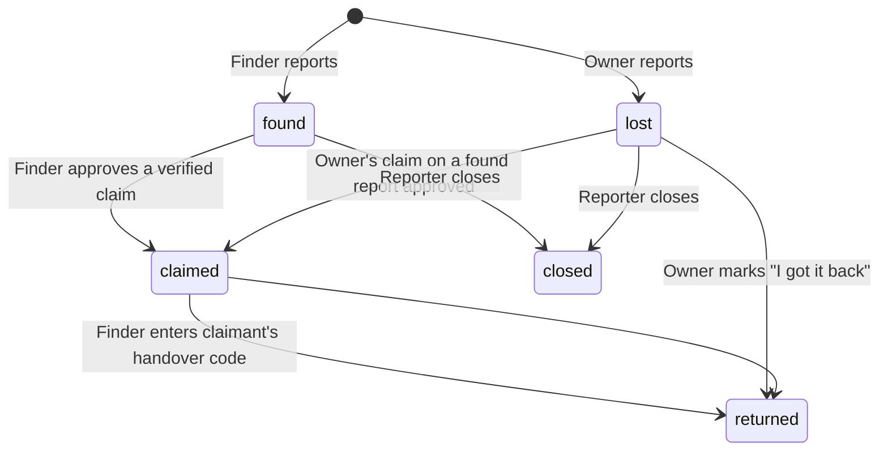
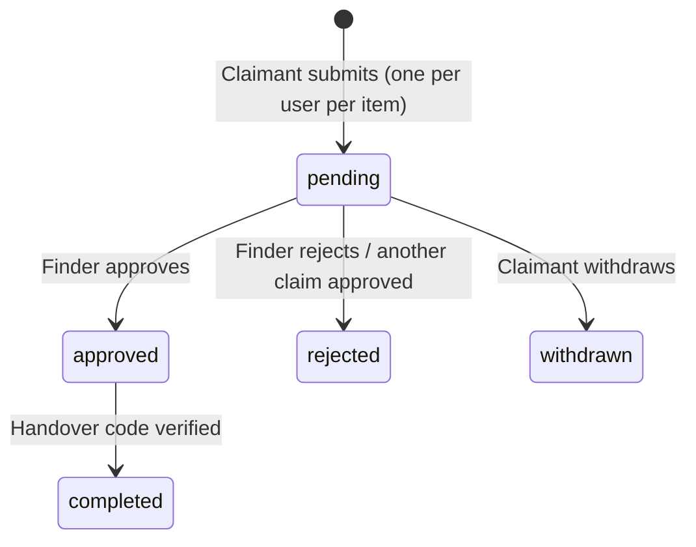

# Database structure & application workflow

## Cloud Firestore

```
users/{uid}                              (owner only)
│   displayName, createdAt, fcmTokens[]
└── notifications/{id}                   (owner only; written by Cloud Functions)
        title, body, data, read, createdAt

items/{itemId}                           (any signed-in user can read)
│   id, type: lost|found
│   status: lost|found|claimed|returned|closed
│   title, description, category, color
│   locationName, lat, lng               ← APPROXIMATE (snapped to ~110 m grid)
│   occurredAt, createdAt, updatedAt
│   reporterId, reporterAlias            ← "Asha R." — never e-mail / full name
│   imageUrls[], imageHashes[]           ← photos are EXIF-stripped; dHash for matching
│   keywords[]                           ← search tokens
│   verificationQuestions[]              ← questions only (found items)
│   linkedItemId                         ← found report answering a lost report
│   approvedClaimId                      ← set when a claim is approved
│   history[] {status, at, note}         ← audit trail shown as a timeline
└── private/secret                       (reporter only)
        answerHashes {"0": [sha256…], "1": […]}, salt
        exactLat, exactLng, privateNotes

claims/{itemId}_{claimantUid}            (claimant + item reporter only)
│   id, itemId, itemTitle, itemReporterId
│   claimantId, claimantAlias
│   answers[], description, proofImageUrl, claimantLostItemId
│   status: pending|approved|rejected|withdrawn|completed
│   rejectionReason, flagReason
│   handoverCodeHash, handoverSalt, handoverCodeEntered
│   createdAt, updatedAt
├── private/handover                     (claimant only)
│       code                             ← plain 6-digit handover code
└── messages/{messageId}                 (claimant + item reporter only)
        senderId, senderAlias, text, createdAt

reports/{id}                             (create-only; moderators read in console)
        itemId, reporterId, reason, createdAt
```

### Firebase Storage

```
items/{itemId}/{n}.jpg        any signed-in user can read; only the reporter can overwrite
claims/{claimId}/proof.jpg    only the claimant and the item's reporter can read
```

### Indexes
`firestore.indexes.json` — `items(type, category, createdAt desc)` for the
match-alert function and `claims(claimantId, createdAt desc)` for the claim
rate-limit check. Everything the app itself queries uses single-field or
equality-only queries (no composite index needed); sorting happens on device.

## Item state machine



Every transition appends to `history[]`, and `firestore.rules` rejects any
transition not in this diagram (e.g. a finder cannot jump `found → returned`
or mark returned without a completed claim).

## Claim state machine



## End-to-end workflow

```mermaid
sequenceDiagram
    actor F as Finder
    participant App
    participant DB as Firestore + Storage
    participant CF as Cloud Functions
    actor O as Owner

    F->>App: Report found item (photos, place, secret Q&A)
    App->>App: Resize, strip EXIF, blur, dHash, hash answers
    App->>App: Queue in outbox (survives offline / app kill)
    App->>DB: Upload photos → write item + private/secret
    DB-->>CF: onItemCreated
    CF->>O: Push "Possible match for your lost item"
    O->>App: Opens item, answers questions, describes item
    App->>DB: claims/{item}_{owner} (pending)
    DB-->>CF: onClaimCreated (rate-limit flag)
    CF->>F: Push "New ownership claim"
    F->>App: Review: auto-score vs hashed answers, proof, chat
    F->>DB: Approve (batch: claim approved + item claimed, others rejected)
    CF->>O: Push "Claim approved"
    O->>App: Generates 6-digit code, stores hash on claim
    F->>O: Meet at security desk; owner reads code aloud
    F->>App: Enters code
    App->>DB: Batch: claim completed + item returned (rules re-check hash)
```
